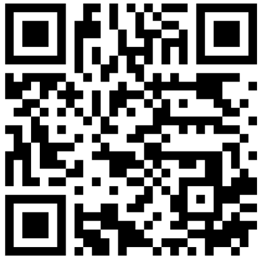

<h1 align="center">Muhammad Saad Irfan</h1>
<h3 align="center">Robotics Software Developer · Robotics Researcher</h3>

  

  Human–Robot Interaction . Social Navigation

  <a href="https://muhammadsaadirfan.github.io/">Portfolio</a> &nbsp;•&nbsp;
  <a href="https://www.linkedin.com/in/muhammad-saad-irfan/">LinkedIn</a> &nbsp;•&nbsp;
  <a href="mailto:saad.robotics.dev@gmail.com">Email</a> &nbsp;•&nbsp;

---

## About Me

I'm a **robotics software developer and researcher** working at the intersection of human–robot interaction, social navigation and mobile robotics. I develop systems that connect sensor data, behavioral models, and motion planning to help robots understand and operate in environments shared with people.

I'm a **Mitacs Globalink Research Intern at Concordia University, Canada**, and a final-year **Mechatronics and Control Engineering student at UET Lahore, Pakistan**. My experience includes working as a **Research Assistant at LUMS**, a **Research Intern at UET Lahore**, and a **freelance robotics software developer on Fiverr**. Across these roles, I have combined academic research with hands-on development in robotics, software, and embedded systems.

## Research Interests

- **Human–Robot Interaction & Social Navigation** — Human-aware motion, personal space, social norms, and robot behavior in shared environments.
- **Robot Perception & Sensor Fusion** — Combining visual, depth, and LiDAR observations for spatial understanding and human tracking under uncertainty.
- **Autonomous Decision-Making** — Integrating perception, prediction, and planning to support context-aware robot behavior.
- **Embodied AI & Robot Learning** — Reinforcement learning and vision-language-action models for adaptive behavior and generalization to real-world settings.

## Skills & Technologies

| Domain | Skills & Tools |
| :--- | :--- |
| **Robotics & Navigation** | ROS 1, ROS 2, Nav2, MoveIt, SLAM, motion planning, TF2 |
| **Perception & Computer Vision** | OpenCV, YOLO, NanoDet, RGB-D processing, LiDAR processing, sensor fusion, human detection and tracking |
| **Programming** | Python, C++, C, Bash |
| **Machine Learning & Analysis** | PyTorch, TensorFlow, NumPy, Pandas, MATLAB, Jupyter |
| **Simulation & Experimentation** | Gazebo, RViz, rosbag recording and playback, sensor diagnostics, simulation-to-hardware integration |
| **Hardware & Embedded Systems** | Hello Robot Stretch 3, Intel RealSense, RPLIDAR, Arduino, Raspberry Pi, NVIDIA Jetson |
| **Development Tools** | Linux/Ubuntu, Git, Docker, CMake, VS Code, LaTeX |

## Connect

I'm open to **robotics research collaborations, software development opportunities, and freelance work** in perception, navigation, automation, and robot integration.

For technical collaboration, consulting, or one-to-one support, reach me at **[msaadmceu@gmail.com](mailto:saad.robotics.dev@gmail.com)** or connect through **[LinkedIn](https://www.linkedin.com/in/muhammad-saad-irfan/)**.
